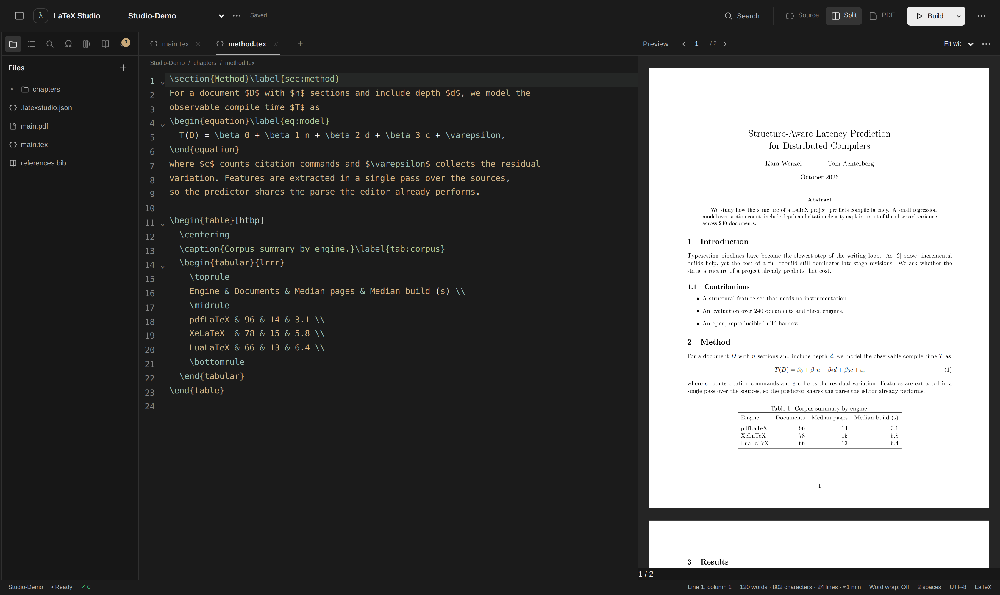

# LaTeX Studio

**A local-first LaTeX workspace.** Write, compile and review technical documents in one window:
a LaTeX-aware editor, a live PDF preview with two-way SyncTeX, a bibliography manager, readable
build diagnostics, and a local history of everything you saved — without an account and without
uploading a single line of your work.



Runs on your machine · uses your own TeX installation · no telemetry · also deployable to
Cloudflare, where pdfLaTeX and XeLaTeX compile inside the visitor's browser.

---

## Highlights

**Editing** — LaTeX syntax highlighting, autocomplete for commands, environments, labels, citation
keys and file paths, snippets with tab stops, automatic `\end{…}`, comment toggle (`Ctrl+/`),
style wrappers (`\textbf`, `\emph`, inline math …), insert wizards, symbol palette and a numbered
table of contents that mirrors the finished PDF.

**Building** — pdfLaTeX, XeLaTeX, LuaLaTeX and pLaTeX per project, auto build, a live compiler
console, a problems panel that links errors back to the exact source line, and package diagnostics
that can install what is missing and rebuild.

**Reviewing** — PDF preview with zoom, page navigation and in-document search. Two-way SyncTeX:
`Ctrl+click` in the PDF jumps to the source line, `Ctrl+Shift+G` highlights the current line's
rectangle on the page.

**References** — a bibliography manager over every `.bib` file of the project: which entries are
cited, which are unused, which citation keys have no entry, one-click citation insertion, and the
raw BibTeX block when you need it. Plus a read-only Zotero browser, BibTeX merge with update
detection and citekey deduplication.

**Writing** — per-project word goals, project-wide `TODO`/`FIXME` tracking, private project notes,
document statistics, a metadata editor for `\title`, `\author`, `\date` and hyperref PDF fields,
focus mode and light/dark themes.

**Keep everything** — a change history with line diffs and one-click restore for every saved
version, project snapshots (manual and automatic), ZIP import/export, public GitHub repository
import, seven document templates and sample projects.

**Collaboration (early)** — editors connected to the same local server see each other in the status
bar and receive each other's saves immediately; unsaved local changes are never overwritten.

---

## Requirements

- Node.js 18 or newer and npm
- A TeX distribution for compilation: TeX Live or MiKTeX (the app starts without one, but building
  and package installation need it)
- Optional: Zotero with Better BibTeX for the reference workflow, Git for version control in your
  project folders

## Quick start

```sh
npm install
npm start
```

Open [http://localhost:4180](http://localhost:4180). The landing page lists the projects in your
installation and links to the workspace at `/studio`.

| Variable | Default | Purpose |
| --- | --- | --- |
| `HOST` | `0.0.0.0` | Bind address — set `127.0.0.1` for local-only access |
| `PORT` | `4180` | HTTP port |
| `LATEX_ROOT` | `<repo>/projects` | Where projects are stored |

Deep links go straight to a document: `/studio?project=Paper&file=chapters/intro.tex&line=42`.

### Cloudflare Pages

```sh
npm ci
npm run deploy:cloudflare
```

This builds the app, downloads the TeX Live 2025 WebAssembly runtime, splits its larger files into
Cloudflare-compatible assets, and publishes the Worker and assets together (about 230 MB of
downloads during deployment). Visitors compile pdfLaTeX and XeLaTeX in the browser; sources and
PDFs stay in that browser's IndexedDB. LuaLaTeX, SyncTeX, local TeX package tooling, GitHub import
and the collaboration features need the local Node.js server. See
[Cloudflare deployment](docs/CLOUDFLARE.md).

---

## Feature reference

### Editor

- CodeMirror 6 with LaTeX tokenizer: commands, environments, math, verbatim, comments, nested braces
- Autocomplete for commands, environments, labels, references, citation keys (with author/year from
  your real BibTeX entries) and file paths; symbol names like `alpha` expand to `\alpha`
- Snippets with placeholders, automatic `\end{…}` closing, environment-aware indentation and folding
- Comment toggle (`Ctrl+/`) and style wrappers: `\textbf`, `\textit`, `\emph`, `\underline`, inline math
- Insert wizards for tables, figures, equations, lists and citations; categorized symbol palette
- Multiple cursors, rectangular selection, bracket matching, word wrap and configurable tab size

### Navigation

- Numbered outline (`Ctrl+Shift+O`): section numbers as in the document, grouped by file, with
  filter, collapse/expand, hierarchy guides and a “show current position” action
- Project-wide search and replace with regex, case and whole-word options (`Ctrl+Shift+F`)
- Quick open (`Ctrl+P`), command palette (`Ctrl+Shift+P`), go to line (`Ctrl+G`), path breadcrumbs
- Deep links to project, file and line

### Build and review

- Engine per project: pdfLaTeX, XeLaTeX, LuaLaTeX, pLaTeX, plus auto build on a delay
- Live console during the build and the raw `.log` afterwards (`Ctrl+J`)
- Problems panel with clickable `file:line` targets; missing packages can be installed and the
  project rebuilt in one action
- Package and document-class diagnostics for TeX Live and MiKTeX
- PDF preview: zoom presets and manual zoom, page navigation, in-document search, open/download
- Two-way SyncTeX, switchable between `Ctrl+click`, every click, or off

### References

- **Bibliography manager** (`Alt+B`): all entries of the project's `.bib` files with type, author,
  year and source file; filters for “cited”, “never cited” and “missing”; citation insertion with
  the correct command for the project (`\cite` or biblatex `\parencite`), copying the BibTeX block,
  and jumping to the entry in its file
- Missing citation keys are reported explicitly instead of failing silently
- Zotero library browser (read-only, 30-second sync, collections, tags, attachment previews) with
  citation insertion and BibTeX merge
- Better BibTeX import with change detection and citekey deduplication
- Browser builds generate a local `.bbl` from the project's `.bib` files, so ordinary citekeys
  resolve without contacting a service

### Writing tools

- Research panel (`Alt+T`): per-project word goal with progress across all files, project-wide task
  tracker for `TODO`, `FIXME`, `XXX`, `NOTE` and `HACK`, and private project notes
- Document statistics with project totals: words, characters, reading time, sections, floats, math
  blocks, citations, labels and TODO notes
- Metadata editor for `\title`, `\author`, `\date`, PDF subject and keywords (written back to the
  source, including `\hypersetup`)
- Focus mode (`Alt+Z`), light/dark/system theme, resizable sidebar, preview and console

### Data and projects

- Change history: every saved version of a file with a line diff and one-click restore, plus a
  journal of saves, snapshots, builds and imports — stored in your browser
- Snapshots: capture all text files before a rewrite; automatic quiet backup every 20 minutes and
  always one before restoring
- ZIP export/import and public GitHub repository import
- Seven templates (article, thesis, beamer, report, letter, mathematics, minimal) and sample projects
- Browser workspace mode for the hosted build: projects, files, search/replace and ZIP transfer in
  IndexedDB, with in-browser compilation

### Collaboration (early)

- Presence of everyone connected to the same project on the same local server, shown in the status bar
- Live file sync: saves from other editors appear immediately; a file with unsaved local changes is
  never overwritten (you are asked to save first)

---

## Keyboard shortcuts

| Action | Shortcut |
| --- | --- |
| Build project | `Ctrl+B` / `F5` |
| Save / save all | `Ctrl+S` / `Ctrl+Shift+S` |
| Command palette | `Ctrl+Shift+P` / `Ctrl+K` |
| Quick open | `Ctrl+P` |
| Project search | `Ctrl+Shift+F` |
| Outline | `Ctrl+Shift+O` |
| Go to line | `Ctrl+G` |
| Preview current line (SyncTeX) | `Ctrl+Shift+G` |
| Source at PDF position | `Ctrl+Shift+L` |
| Toggle comment | `Ctrl+/` |
| Bold · italic · emphasis · underline · math | `Alt+Shift+B` · `I` · `E` · `U` · `M` |
| Bibliography manager | `Alt+B` |
| Research panel | `Alt+T` |
| Focus mode | `Alt+Z` |
| Console | `Ctrl+J` |
| Toggle preview / sidebar | `Ctrl+\` / `Ctrl+Shift+B` |
| Zoom preview in / out / fit | `Ctrl+=` / `Ctrl+-` / `Ctrl+0` |
| Shortcut reference | `F1` |

---

## Documentation

- [User guide](docs/USER_GUIDE.md) — day-to-day workflows
- [Integrations](docs/INTEGRATIONS.md) — Zotero, Better BibTeX, GitHub, TeX packages
- [Architecture](docs/ARCHITECTURE.md) — local server, browser workspace, collaboration channel
- [Security notes](docs/SECURITY.md) — trusted-network assumptions and data locations
- [Cloudflare deployment](docs/CLOUDFLARE.md) — hosting and browser compilation
- [Run and verify](RUNNING.md) — development commands and what the checks cover

## Development

```sh
npm run build     # bundle the browser app (+ Cloudflare asset preparation)
npm run verify    # non-destructive application checks
npm run serve     # start the server (use scripts in another terminal)
npm run deploy:cloudflare
```

`npm run verify` starts its own server when none is listening, creates uniquely named disposable
projects, and removes them afterwards. It checks project and file management, saving, search and
replace, package diagnostics, available TeX engines, bibliography merging and BibTeX parsing, error
handling, SyncTeX in both directions, and ZIP import/export. It does not install TeX packages and
cannot prove that every document compiles on every TeX distribution.

## Data and privacy

Projects live in your filesystem under `projects/` (excluded from version control) or, in the hosted
build, in your browser's IndexedDB. Change history, snapshots, word goals and notes are stored in
your browser. There is no telemetry and no LaTeX Studio account. Network access happens only when
you use it: GitHub import downloads a public repository archive, and the Zotero integration talks
directly to `api.zotero.org` with a key you provide. Collaboration messages stay on your local
server — the app has no relay service. See [Security notes](docs/SECURITY.md) before exposing the
server to a network you do not control.

## Project layout

```
client/       browser app: index.html (landing), studio.html (workspace), src/, styles/, dist/
server/       Express API, TeX build runner, WebSocket collaboration, project utilities
templates/    document templates used by “New project”
docs/         user guide, integrations, architecture, security, Cloudflare notes
scripts/      verification suite and Cloudflare asset preparation
screenshots/  image used by this README
worker.js     Cloudflare Worker entry point
```

## License

LaTeX Studio is published without a license declaration in this initial release. All rights are
reserved by default; obtain permission before redistributing or reusing the code.
